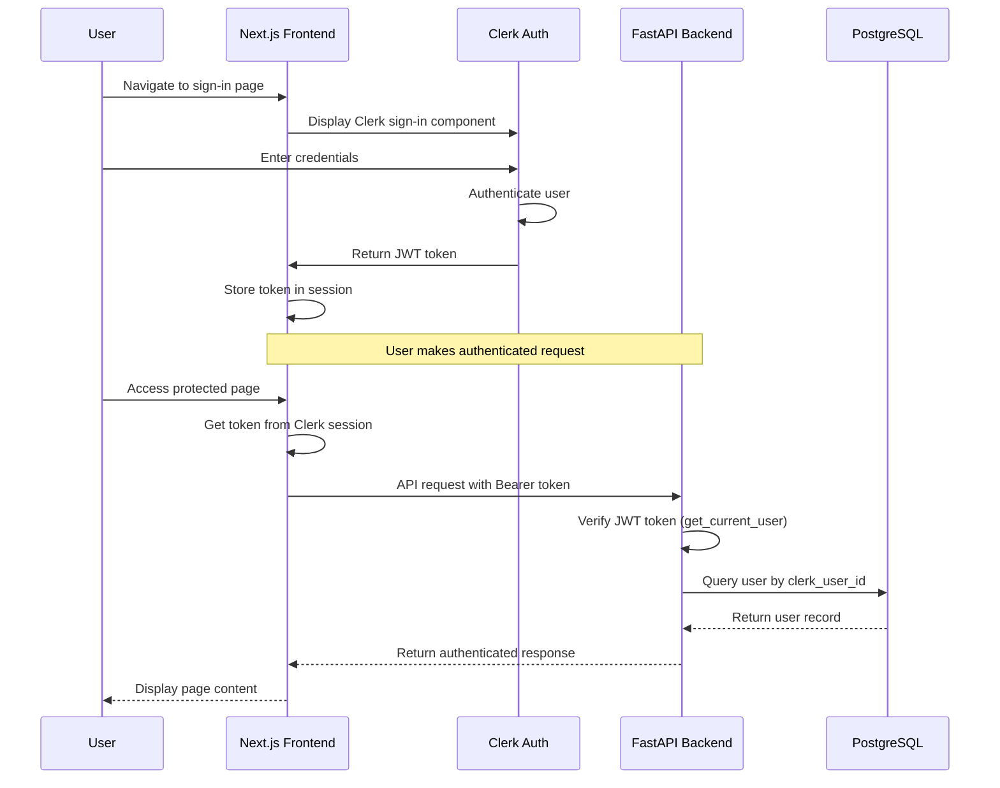
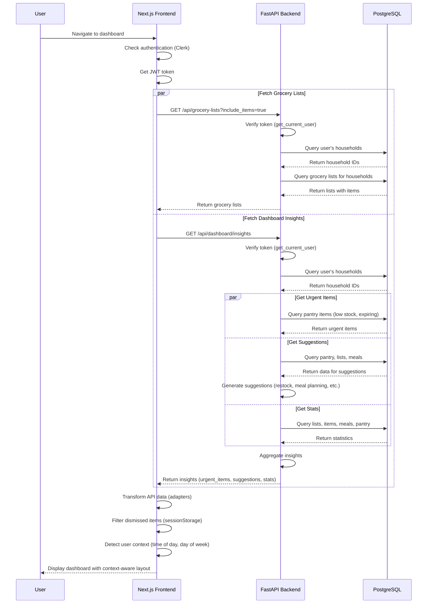
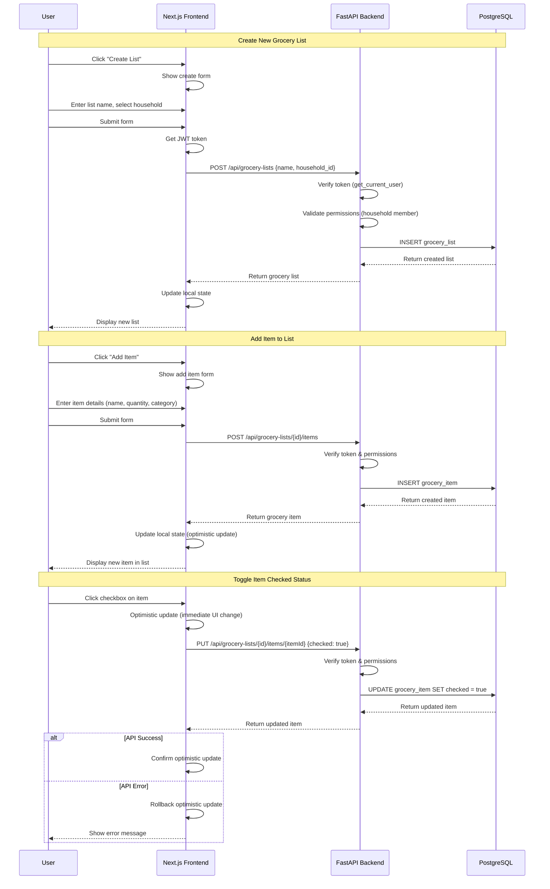
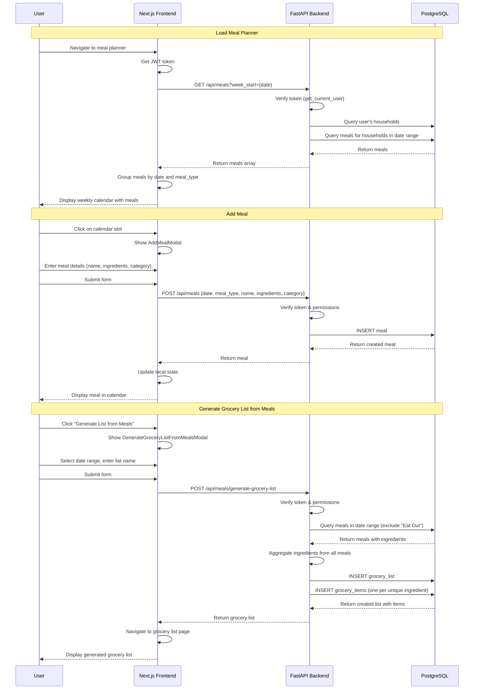
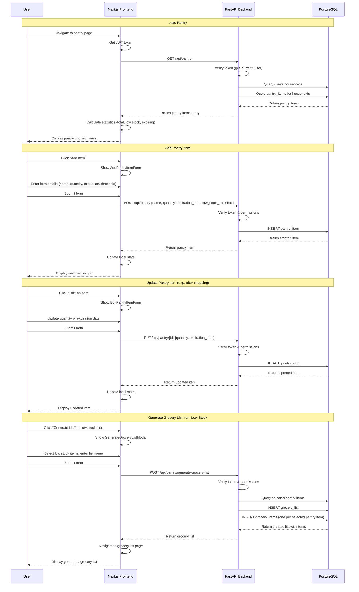
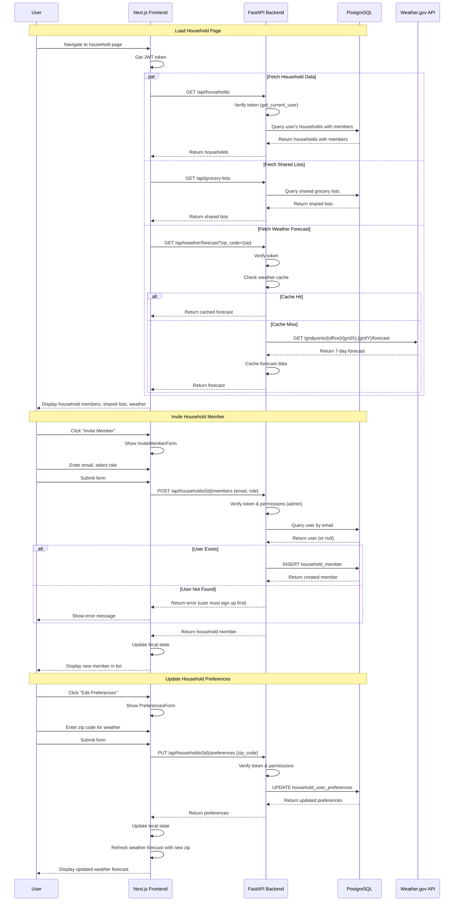
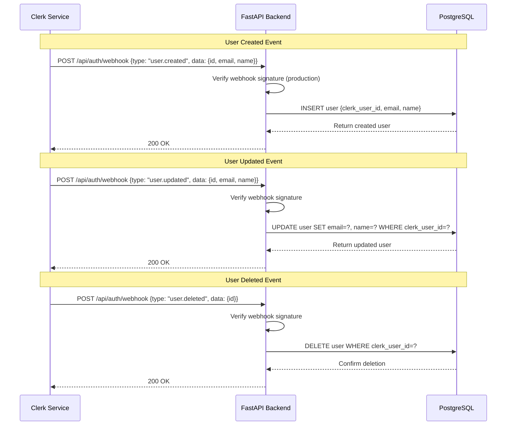
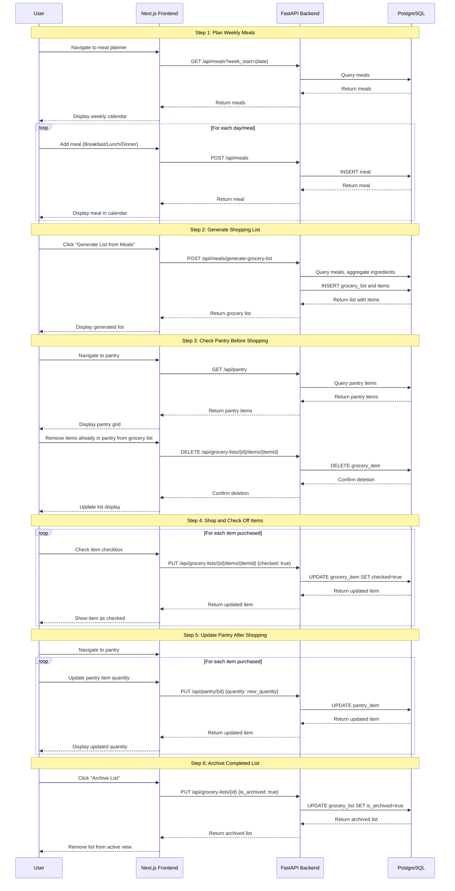
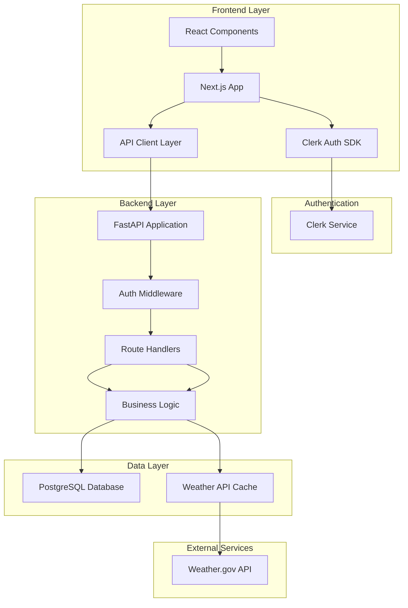
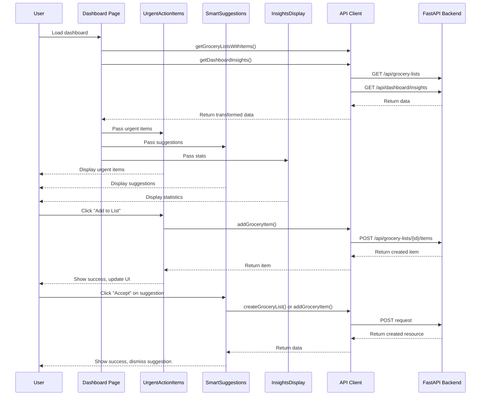

# Grocery List App - Sequence Diagrams

This document contains sequence diagrams illustrating the key user flows and system interactions in the Grocery List App.

## Authentication Flow

## Dashboard Load Flow

## Grocery List Management Flow

## Meal Planning Flow

## Pantry Management Flow

## Household Management Flow

## Clerk Webhook Flow (User Sync)

## Complete User Journey: Planning Meals and Shopping

## System Architecture Overview

## Key Components Interaction

---

## Notes

- **Authentication**: All API requests (except webhooks) require a valid Clerk JWT token in the Authorization header
- **Error Handling**: Frontend implements optimistic updates with rollback on error for better UX
- **Caching**: Weather forecasts are cached in the backend to reduce API calls
- **Permissions**: Backend validates user permissions (household membership, admin roles) for all operations
- **Data Transformation**: Frontend uses adapter pattern to transform API responses to UI-friendly formats
- **Session Storage**: Dismissed items and suggestions are stored in browser sessionStorage for the current session
